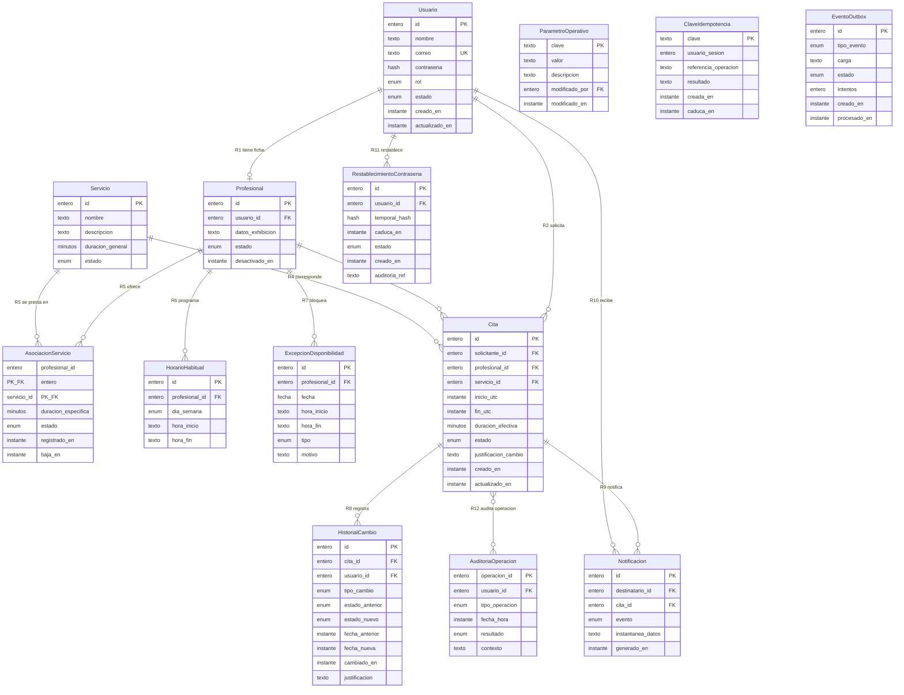

# Diagrama entidad-relación
## Sistema Web de Gestión de Citas y Atención Virtual

**Workflow:** `02_database_workflow` — Paso 03 (diagrama E-R).
**Skill:** `database-schema-designer`.
**Fecha:** 8 de octubre de 2026.
**Entradas:** `proyecto/05_base_datos/02_modelo_conceptual/modelo_conceptual.md` (Paso 02 **aprobado**, A-01…A-05 aplicadas), `requisitos_datos.md` (Paso 01 aprobado).
**Restricción:** representación conceptual versionable en Mermaid; **sin SQL, sin migraciones, sin motor de base de datos**.

---

## 1. Diagrama E-R

## 2. Leyenda de cardinalidades (convención Mermaid)

| Símbolo | Significado | Uso en este diagrama |
|---|---|---|
| `\|\|` | exactamente uno | lado obligatorio único (ej. la cita de R8) |
| `o\|` | cero o uno | R1: usuario puede no tener ficha de profesional |
| `\|}` | uno o muchos | — (no usado; los múltiplos admiten cero, ver `o{`) |
| `o{` | cero o muchos | R2…R11: uno a N con N ≥ 0 (E2…E14 admiten existir sin participaciones previas) |
| `}o` / `o{` | cero o muchos a ambos lados | R12: N : 0..N (auditoría por operación) |

La tabla de referencia `modelo_conceptual.md` §3 usa notación "1 : N"; aquí se traduce a símbolos Mermaid conservando el sentido (E-side = N). Los "0..N" se representan como `o{`.

## 3. Relaciones representadas (trazabilidad R1…R12)

| # | Relación en el diagrama | Cardinalidad (§3) | Requisitos |
|---|---|---|---|
| R1 | Usuario \|\|—o\| Profesional | 1 : 0..1 | RF-003, RF-004 |
| R2 | Usuario \|\|—o{ Cita (solicitante) | 1 : N | RF-015, RF-016 |
| R3 | Profesional \|\|—o{ Cita | 1 : N | RN-01, RN-03 |
| R4 | Servicio \|\|—o{ Cita | 1 : N | RN-01 |
| R5 | Profesional \|\|—o{ Asociación —o{ Servicio (entidad asociativa E4) | N : M | RF-006, RN-04, RN-16 |
| R6 | Profesional \|\|—o{ Horario habitual | 1 : 0..N | RF-007 |
| R7 | Profesional \|\|—o{ Excepción de disponibilidad | 1 : 0..N | RF-008 |
| R8 | Cita \|\|—o{ Historial de cambios | 1 : 0..N | RF-022, CA-006 |
| R9 | Cita \|\|—o{ Notificación | 1 : 0..N | RF-024 |
| R10 | Usuario \|\|—o{ Notificación (destinatario) | 1 : 0..N | RF-028 |
| R11 | Usuario \|\|—o{ Restablecimiento de contraseña | 1 : 0..N | RF-029 |
| R12 | Cita }o—o{ Auditoría de operaciones | N : 0..N | RF-026, RNF-013 |

**Notas de representación:**
- **R5:** la cardinalidad N:M se materializa con la entidad asociativa **E4** (profesional + servicio como clave compuesta), portadora de duración específica y estado (RN-04, RN-16).
- **R12:** conserva la decisión de §3 — la auditoría se organiza por **operación**, no como atributo obligatorio de la cita; también cubre operaciones sin cita (restablecimiento).
- Las citas **no** referencian a la asociación E4 directamente (decisión 1 de `modelo_conceptual.md` §5, A-01): solo el par (profesional, servicio) y la duración efectiva persisten en la cita.

## 4. Entidades sin relaciones en R1…R12 y observaciones para el Paso 04

- **E11 Parámetro operativo, E12 Clave de idempotencia:** entidades de soporte independientes (RF-025, RNF-012); referencias de atributo a `Usuario` (modificado_por, usuario_sesion) sin relación formal en §3.
- **E13 Evento outbox:** registrado en la misma transacción que la cita (RNF-017) pero **sin relación R#** en el modelo aprobado.
- **E8 Historial / E9 Auditoría:** portan `usuario_id` (usuario responsable) como atributo, sin relación formal en §3.
- **Observación no bloqueante para el Paso 04:** evaluar si formalizar como relaciones adicionales las referencias usuario→E8/E9/E11 y cita→E13. **Requiere aprobación humana**; no se modifica el modelo conceptual aprobado de forma silenciosa.

## 5. Verificaciones

- Cobertura: las 14 entidades (E1…E14) y las 12 relaciones (R1…R12) del modelo conceptual aparecen en el diagrama.
- Cardinalidades idénticas a `modelo_conceptual.md` §3 (traducción notacional única, §2 de este documento).
- Sin SQL, sin tipos de motor (tipos Mermaid genéricos de uso conceptual: `entero`, `texto`, `instante`, `enum`, `minutos`, `fecha`, `hash`).
- Decisiones A-01…A-05 reflejadas: asociación validada al crear/reprogramar sin FK permanente (A-01), sin atributo "fecha" en Cita (A-02), estados de bloqueo en la semántica de R3/R8 (A-03), instantánea en Notificacion (A-04), excepción con horas opcionales (A-05).
- Pendientes no bloqueantes vigentes: valor de anticipación para reservar (OD-01) y canal seguro de contraseñas temporales (OD-02).
- Validador gráfico `mmdc` no disponible en el entorno; no se instalan herramientas (restricción del workflow). La sintaxis se revisó estructuralmente conforme a la especificación Mermaid `erDiagram`.

**Estado del paso:** completado y presentado. **HUMAN_STATUS: PENDING** — revisión humana del diagrama E-R solicitada antes de avanzar al Paso 04 (modelo lógico).
