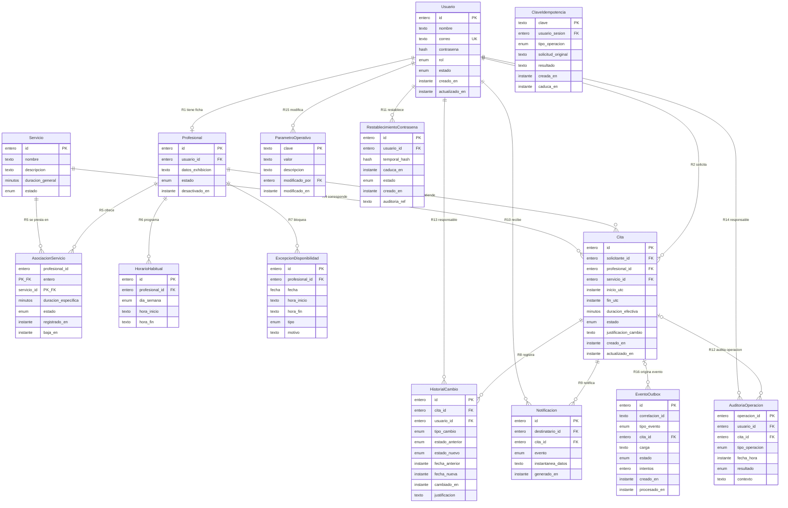

# Diagrama entidad-relación
## Sistema Web de Gestión de Citas y Atención Virtual

**Workflow:** `02_database_workflow` — Paso 03 (diagrama E-R).
**Skill:** `database-schema-designer`.
**Fecha:** 8 de octubre de 2026.
**Entradas:** `proyecto/05_base_datos/02_modelo_conceptual/modelo_conceptual.md` (Paso 02 **aprobado**, A-01…A-05 aplicadas), `requisitos_datos.md` (Paso 01 aprobado).
**Revisiones aplicadas:** observaciones **ER-01…ER-05 aprobadas** por el responsable (8 de octubre de 2026) — `proyecto/04_decisiones/decisiones_paso03_er01_er05.md`; evidencia previa en `proyecto/03_resultados/evidencia_pre_er01_05/`. **Corrección técnica de sintaxis Mermaid en R12/R16** (`|o` → `o|`) autorizada por el responsable — evidencia en `proyecto/03_resultados/evidencia_pre_correccion_mermaid/`.
**Restricción:** representación conceptual versionable en Mermaid; **sin SQL, sin migraciones, sin motor de base de datos**.

---

## 1. Diagrama E-R

## 2. Leyenda de cardinalidades (convención Mermaid)

**Regla de orientación:** el símbolo **pegado a una entidad** describe **cuántas instancias de esa entidad** participan por cada instancia de la entidad opuesta. Verificado línea a línea en §5.

| Símbolo | Significado | Uso en este diagrama |
|---|---|---|
| `\|\|` | exactamente uno | lado obligatorio único (ej. un registro de historial → 1 usuario responsable, R13) |
| `o\|` | cero o uno | R1 (`o\|` en Profesional: 0..1 ficha por usuario); **R12** y **R16** (`o\|` en Cita: cada auditoría/evento → 0..1 cita) |
| `}\|` / `\|{` | uno o muchos (izq. / der.) | — (no usado: los múltiplos del modelo admiten cero) |
| `o{` / `}o` | cero o muchos (der. / izq.) | R2…R11, **R13…R16**: lado múltiple con ≥ 0 participaciones |

**Traducción de la notación §3 del modelo:** "1 : 0..N" → `||` en el lado uno y `o{` en el lado N; "0..1" en el lado opcional → `o|` (ej. R12, R16). R5 (N:M) se modela con la entidad asociativa E4.

**Ajuste técnico de sintaxis (Paso 03):** la gramática oficial de Mermaid acepta `o|` y `|o` como el mismo token `ZERO_OR_ONE` en cualquier lado de la relación; conforme a la corrección del responsable, R12 y R16 se escriben con **`o|`** en el lado de Cita (la documentación de Mermaid muestra `|o` en la columna izquierda y `o|` en la derecha — ambas válidas). Verificado contra la gramática `erDiagram.jison` de Mermaid (v12.1). Evidencia previa: `proyecto/03_resultados/evidencia_pre_correccion_mermaid/`.

## 3. Relaciones representadas (trazabilidad R1…R12)

| # | Relación en el diagrama | Cardinalidad (§3) | Requisitos |
|---|---|---|---|
| R1 | Usuario \|\|—o\| Profesional | 1 : 0..1 | RF-003, RF-004 |
| R2 | Usuario \|\|—o{ Cita (solicitante) | 1 : N | RF-015, RF-016 |
| R3 | Profesional \|\|—o{ Cita | 1 : N | RN-01, RN-03 |
| R4 | Servicio \|\|—o{ Cita | 1 : N | RN-01 |
| R5 | Profesional \|\|—o{ Asociación —o{ Servicio (entidad asociativa E4) | N : M | RF-006, RN-04, RN-16 |
| R6 | Profesional \|\|—o{ Horario habitual | 1 : 0..N | RF-007 |
| R7 | Profesional \|\|—o{ Excepción de disponibilidad | 1 : 0..N | RF-008 |
| R8 | Cita \|\|—o{ Historial de cambios | 1 : 0..N | RF-022, CA-006 |
| R9 | Cita \|\|—o{ Notificación | 1 : 0..N | RF-024 |
| R10 | Usuario \|\|—o{ Notificación (destinatario) | 1 : 0..N | RF-028 |
| R11 | Usuario \|\|—o{ Restablecimiento de contraseña | 1 : 0..N | RF-029 |
| R12 | Cita o\|—o{ Auditoría de operaciones | **1 : 0..N** con auditoría → **0..1 cita** **(modificada por ER-04; antes N : 0..N)** | RF-026, RNF-013, RF-029 (operaciones sin cita) |
| R13 | Usuario \|\|—o{ Historial de cambios (responsable) | 1 : 0..N, responsable NO NULO | RF-021, RF-022 (ER-01) |
| R14 | Usuario \|\|—o{ Auditoría (responsable) | 1 : 0..N, responsable NO NULO | RF-026, RNF-013 (ER-01) |
| R15 | Usuario \|\|—o{ Parámetro operativo (modificador) | 1 : 0..N, modificador NO NULO | RF-025 (ER-01) |
| R16 | Cita o\|—o{ Evento outbox | **1 : 0..N** con evento → **0..1 cita**; correlación por `correlacion_id` | RF-024, RNF-017 (ER-03) |

**Notas de representación:**
- **R5:** la cardinalidad N:M se materializa con la entidad asociativa **E4** (profesional + servicio como clave compuesta), portadora de duración específica y estado (RN-04, RN-16) — **ER-05: clave compuesta mantenida**, desactivación/reactivación sin eliminación física y sin historiales nuevos.
- **R12 (ER-04):** una fila de auditoría corresponde a **una operación** que toca a lo sumo una cita o ninguna (restablecimiento de contraseña). Sustituye al `}o—o{` del Paso 02; el lado cita queda `o|` (0..1 por auditoría) y el lado auditoría `o{` (0..N por cita). Conserva la decisión de `modelo_conceptual.md` §5.5: auditoría **por operación**.
- **R13…R16 (ER-01, ER-03):** formalizan referencias de atributo ya existentes en el modelo; ninguna entidad nueva.
- **R16:** el lado cita es `o|` (evento → 0..1 cita) para no imponer vínculo obligatorio con Cita a eventos fuera del alcance actual; todos los eventos vigentes del alcance (RF-024) llevan cita.
- Las citas **no** referencian a la asociación E4 directamente (decisión 1 de `modelo_conceptual.md` §5, A-01): solo el par (profesional, servicio) y la duración efectiva persisten en la cita.

## 4. Entidades sin relación formal en R1…R16

- **E12 Clave de idempotencia:** vinculada con la identidad del solicitante mediante el atributo `usuario_sesion` (FK conceptual, **ER-02 aprobada**) y con la operación protegida mediante `tipo_operacion` + `solicitud_original` + `resultado`; **sin relación formal en §3** — ER-01 se aprobó para E8/E9/E11 y no la incluyó. Formalizarla en el Paso 04 (p. ej. R17) exigiría aprobación humana.
- **E11 Parámetro operativo** y **E13 Evento outbox** quedaron **con relación formal** (R15 y R16) tras ER-01 y ER-03; su vínculo a Usuario/Cita ya no es solo de atributo.

## 5. Verificaciones

- Cobertura: las 14 entidades (E1…E14) y las relaciones **R1…R16** (R5 representada en dos líneas; R12 modificada con ER-04 y R13…R16 nuevas) de `modelo_conceptual.md` §3.
- **Orientación de cardinalidades verificada con la regla §2:** R12 `Cita o|—o{ Auditoria` → cada auditoría: 0..1 cita; cada cita: 0..N auditorías. R16 `Cita o|—o{ EventoOutbox` → cada evento: 0..1 cita; cada cita: 0..N eventos. R13…R15 `Usuario ||—o{ …` → cada registro: exactamente 1 usuario; cada usuario: 0..N registros. R1 sin cambios.
- **Sintaxis verificada** contra la gramática oficial Mermaid `erDiagram.jison` (v12.1): las 17 líneas de relación usan solo tokens válidos (`||`, `o|`, `o{`); `o|`/`|o` son sinónimos `ZERO_OR_ONE`. Corrección `|o` → `o|` en R12/R16 aplicada por instrucción del responsable.
- Cardinalidades idénticas a `modelo_conceptual.md` §3.
- Sin SQL, sin tipos de motor (tipos Mermaid genéricos de uso conceptual: `entero`, `texto`, `instante`, `enum`, `minutos`, `fecha`, `hash`).
- Decisiones reflejadas: **A-01…A-05** (asociación sin FK en la cita, sin "fecha" en Cita, estados bloqueantes, instantánea de notificación, excepciones con horas opcionales) y **ER-01…ER-05** (R13…R15, idempotencia con rechazo de conflicto, R16 con correlación, R12 refinada, clave compuesta de E4 mantenida). Ninguna contradice ADR-001 (una única BD relacional del monolito).
- Pendientes no bloqueantes vigentes: valor de anticipación para reservar (OD-01) y canal seguro de contraseñas temporales (OD-02).
- Validador gráfico `mmdc` no disponible en el entorno; no se instalan herramientas (instrucción 11). La sintaxis se revisó estructuralmente conforme a la especificación Mermaid `erDiagram`.

**Estado del paso:** **APROBADO por el responsable** el 8 de octubre de 2026 (ER-01…ER-05 aplicadas, corrección Mermaid R12/R16 verificada). **HUMAN_STATUS: APPROVED_STEP_03 — WAITING_FOR_STEP_04_AUTHORIZATION** — el Paso 04 requiere autorización explícita. Evidencia: `proyecto/03_resultados/evidencia_pre_er01_05/`, `evidencia_pre_correccion_mermaid/`, `evidencia_pre_aprobacion_paso03/`.
